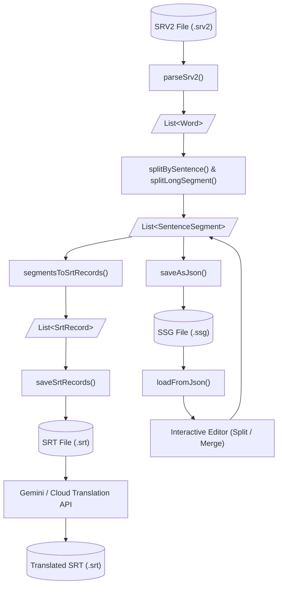

# edit_srt_for_youtube

A Flutter desktop application for downloading YouTube videos/subtitles, converting and editing subtitle files, and translating subtitles into Japanese using Google Gemini or Google Cloud Translation.

## Features

The application provides the following core tools accessible from the main menu:

### 1. Download Video Only
- **Download by URL**: Paste a YouTube video URL to fetch metadata (title and thumbnail).
- **Download Video**: Download highest quality muxed MP4 streams with real-time download progress tracking and cancellation support.
- **Custom Output Folder**: Saves video files directly to the directory configured in Settings.

### 2. Subtitle -> Sentence Segment (`.ssg`)
- **Convert SRV2 Subtitles**: Select an existing YouTube caption XML/SRV2 file (`.srv2`) and parse word-level timestamps.
- **Sentence & Segment Splitting**: Group words into natural sentence units and split long sentences on punctuation/commas into structured sentence segments.
- **JSON Export**: Output sentence segments to `.ssg` (JSON format) for manual inspection and editing.

### 3. Download Video & Subtitles
- **Batch Download**: Simultaneously download the video along with YouTube subtitles (`srv2`).
- **Automatic Conversion**: Automatically converts downloaded subtitles into standard `.srt` format.

### 4. Edit Subtitles
- **Load Sentence Segments**: Open a `.ssg` file to review segments broken down word-by-word.
- **Split & Merge**:
  - Split long segments into smaller units at a selected word.
  - Merge adjacent segments into a single segment.
- **Export to SRT**: Export edited sentence segments back into a standard `.srt` subtitle file.

### 5. Translate Subtitles
- **Dual Translation Engines**: Translate English `.srt` subtitles into Japanese using either:
  - **Google Gemini API** (`gemini-2.5-flash`)
  - **Google Cloud Translation API** (`v2`)
- **Strict Timestamp Preservation**: Retains exact subtitle record IDs and timestamps (`00:00:00,000 --> 00:00:00,000`), only translating the subtitle text lines.
- **Output**: Saves the translated subtitle file as `[original_name]_JP.srt`.

### 6. Settings
- Configure and persist the default download/output folder path using `shared_preferences`.

---

## Setup & Configuration

### Prerequisites
- [Flutter SDK](https://docs.flutter.dev/get-started/install) (Dart SDK `^3.9.2`)
- [yt-dlp](https://github.com/yt-dlp/yt-dlp): Required for downloading videos and YouTube subtitles. Ensure `yt-dlp` is installed and accessible in your system `PATH`.
  - **Windows**: `winget install yt-dlp` or `choco install yt-dlp`
  - **macOS**: `brew install yt-dlp`
  - **Linux**: `sudo apt install yt-dlp` or see [yt-dlp release page](https://github.com/yt-dlp/yt-dlp#installation)

### 1. Clone the repository
```sh
git clone <repository-url>
cd edit-srt-for-youtube
```

### 2. Install dependencies
```sh
flutter pub get
```

### 3. API Keys Configuration
Depending on the translation method you use, set the following environment variables:

- **Google Gemini Translation**:
  Set `GEMINI_API_KEY`:
  ```sh
  export GEMINI_API_KEY="your-gemini-api-key"        # macOS / Linux
  set GEMINI_API_KEY="your-gemini-api-key"           # Windows CMD
  $env:GEMINI_API_KEY="your-gemini-api-key"          # Windows PowerShell
  ```
- **Google Cloud Translation**:
  Set `TTS_API_KEY` (or Google Cloud API Key with Cloud Translation API enabled):
  ```sh
  export TTS_API_KEY="your-google-cloud-api-key"     # macOS / Linux
  set TTS_API_KEY="your-google-cloud-api-key"        # Windows CMD
  $env:TTS_API_KEY="your-google-cloud-api-key"       # Windows PowerShell
  ```

### 4. Run the application
```sh
flutter run -d windows    # or macos / linux
```

---

## Architecture & Data Flow

