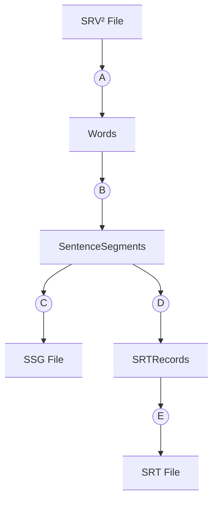

# edit_srt_for_youtube

A Flutter desktop application for downloading, editing, and translating YouTube video subtitles. This tool is designed to streamline the workflow for creating and modifying subtitle files for video content.

## Features

The application is divided into three main modules:

### 1. Download Video & Subtitles

- **Download from URL**: Enter a YouTube video URL to download the video and its subtitles.
- **Format Conversion**: Automatically fetches subtitles (in `srv2` format) and converts them into:
  - A standard `.srt` file.
  - A custom `.ssg` (Sentence Segment) file, optimized for the editing screen.

### 2. Edit Subtitles

- **Load & Edit**: Load a `.ssg` file to view subtitles broken down into sentence segments.
- **Split Segments**: Easily split a long segment into two at a specific word by clicking on it.
- **Merge Segments**: Merge adjacent segments into a single, longer segment.
- **Export**: Export the edited segments back into a standard `.srt` file.

### 3. Translate Subtitles

- **AI-Powered Translation**: Load an English `.srt` file and use the Google Gemini API to translate the subtitle text into Japanese.
- **Preserve Timestamps**: The translation process strictly preserves the original timestamps and record IDs, ensuring the translated subtitles are perfectly synced.
- **Save Translated File**: Saves the translated content as a new `[original_name]_JP.srt` file.

## Setup

1. **Clone the repository.**
   ```sh
   git clone <repository-url>
   ```
2. **Install Flutter dependencies.**
   ```sh
   flutter pub get
   ```
3. **Set up Gemini API Key.**
   - This application uses the Google Gemini API for the translation feature.
   - You must set an environment variable named `GEMINI_API_KEY` with your valid API key for the translation feature to work.

## Info for Dev
